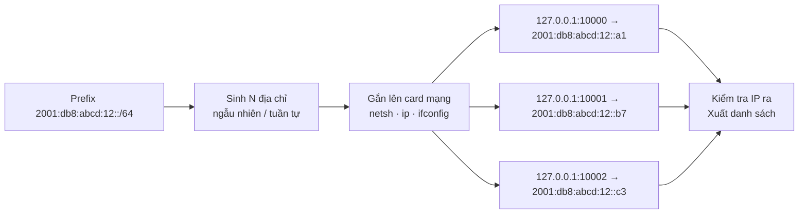

<p align="center">
  <picture>
    <source media="(prefers-color-scheme: dark)" srcset="assets/logo-wordmark-dark.svg">
    
  </picture>
</p>

<p align="center">
  <b>Biến một prefix IPv6 thành hàng nghìn proxy HTTP/SOCKS5, mỗi proxy một IP ra riêng.</b><br>
  Ứng dụng desktop viết bằng Rust · Windows · Linux · macOS
</p>

---

## Giới thiệu

Nhà mạng và VPS thường cấp cho mỗi đường truyền cả một dải IPv6 (thường là `/64`, tức 2⁶⁴ địa chỉ), nhưng máy chỉ dùng một vài địa chỉ trong số đó.
**ProxyV6 MMO** tận dụng phần còn lại:

1. Sinh hàng loạt địa chỉ IPv6 nằm trong prefix của bạn.
2. Gắn các địa chỉ đó lên card mạng.
3. Mở một cổng proxy cục bộ cho mỗi địa chỉ. Mọi kết nối đi qua cổng nào sẽ ra Internet bằng đúng IPv6 của cổng đó.
4. Kiểm tra từng proxy và xuất danh sách để dùng cho trình duyệt antidetect, tool MMO, scraper...



## Tính năng

| Nhóm | Chi tiết |
|---|---|
| **Card mạng** | Liệt kê card mạng kèm MAC, IPv4, IPv6 và trạng thái kết nối. Có thể lọc chỉ card có IPv6 global. |
| **Prefix** | Tự phát hiện IPv6 public và prefix, hoặc nhập prefix tùy chỉnh (độ dài `/16` – `/120`, mặc định `/64`). |
| **Sinh địa chỉ** | Tối đa **10.000** địa chỉ mỗi lần, chế độ **ngẫu nhiên** (không trùng lặp) hoặc **tuần tự** từ một offset (ví dụ `0x1000`). |
| **Áp dụng** | Thêm/gỡ địa chỉ theo lựa chọn hoặc hàng loạt. Tùy chọn *persistent* (giữ sau khi khởi động lại) và *nodad* (bỏ qua kiểm tra trùng). |
| **Proxy** | Mỗi địa chỉ một cổng, cổng tăng dần từ *Cổng đầu*. Một cổng nhận cả **HTTP** (kể cả `CONNECT`) lẫn **SOCKS5**, tự nhận diện giao thức. Có xác thực user/pass tùy chọn. |
| **Kiểm tra** | Gửi request qua từng proxy tới URL kiểm tra IP, chạy song song nhiều luồng, có timeout. Cột ✓ *trùng* cho biết IP ra đúng là IPv6 được gán cho cổng đó. Có thể kiểm tra lại riêng các proxy lỗi. |
| **Xuất** | 5 định dạng, phạm vi *Tất cả / Đã chọn / Đã thêm*, sao chép vào clipboard hoặc lưu ra file. |
| **Giao diện** | Giao diện dark/light, tiếng Việt, nhật ký có thể lọc chỉ lỗi, tự lưu cài đặt và danh sách địa chỉ đã gắn. |

## Yêu cầu

- **Đường truyền có IPv6 global** và nhà mạng/VPS định tuyến cả prefix về máy của bạn. Nếu router chỉ cấp một địa chỉ đơn lẻ thì các địa chỉ sinh thêm sẽ không ra được Internet.
- **Quyền quản trị** để thêm/gỡ địa chỉ trên card mạng:
  - Windows: chạy bằng *Run as administrator*, hoặc bấm nút *Chạy lại với quyền Admin* trong app.
  - Linux: `sudo -E ./proxyv6-mmo` hoặc `pkexec env DISPLAY=$DISPLAY XAUTHORITY=$XAUTHORITY ./proxyv6-mmo`.
  - macOS: `sudo ./proxyv6-mmo`.
- Công cụ hệ thống: `netsh` (Windows), `iproute2` (Linux), `ifconfig` (macOS).

## Build từ mã nguồn

Cần [Rust](https://rustup.rs) bản stable (edition 2021).

```bash
git clone <repo-url> proxyv6-mmo
cd proxyv6-mmo
cargo build --release
```

File chạy nằm ở:

| Hệ điều hành | Đường dẫn |
|---|---|
| Windows | `target\release\proxyv6-mmo.exe` |
| Linux / macOS | `target/release/proxyv6-mmo` |

> Trên Windows, icon được nhúng vào file `.exe` lúc build nên cần có Windows SDK (đi kèm *Build Tools for Visual Studio*).

## Hướng dẫn sử dụng

Quy trình trong app: **1 Chọn card → 2 Tạo → 3 Áp dụng → 4 Chạy proxy → 5 Kiểm tra → 6 Xuất**

1. **Chọn card mạng** ở thanh bên trái. Nên bật *Chỉ hiện card có IPv6 global*.
2. **Tạo địa chỉ** (tab *Tạo địa chỉ*): bấm *Tự phát hiện IPv6 public* để lấy prefix, chọn số lượng và chế độ, rồi bấm *Tạo danh sách*.
3. **Áp dụng** (tab *Địa chỉ & Proxy*): bấm *Áp dụng tất cả chờ* để gắn các địa chỉ lên card.
4. **Chạy proxy**: trong *Cấu hình proxy*, chọn IPv4 lắng nghe (mặc định `127.0.0.1`), cổng đầu (mặc định `10000`) và xác thực nếu cần, rồi bấm *Chạy proxy*.
5. **Kiểm tra**: bấm *Kiểm tra N proxy*. Proxy *Sống* có dấu ✓ *trùng* là proxy đã ra Internet đúng IPv6 của nó.
6. **Xuất**: chọn định dạng và phạm vi, rồi sao chép hoặc lưu file.

Dùng xong, bấm *Gỡ tất cả đã thêm* để trả card mạng về trạng thái ban đầu.

### Định dạng xuất

| Định dạng | Ví dụ |
|---|---|
| Chỉ IP | `2001:db8:abcd:12::a1` |
| `[IP]:cổng` | `[2001:db8:abcd:12::a1]:8080` |
| `IP/prefix` | `2001:db8:abcd:12::a1/64` |
| `ip:cổng` (proxy) | `127.0.0.1:10000` |
| `ip:cổng:user:pass` (proxy) | `127.0.0.1:10000:user:pass` |

Ví dụ dùng proxy vừa tạo:

```bash
curl -x http://127.0.0.1:10000 http://api6.ipify.org
curl --socks5-hostname 127.0.0.1:10001 http://api6.ipify.org
```

## Cài đặt & dữ liệu

Cài đặt và danh sách địa chỉ đã gắn được lưu trong `state.json`. Đường dẫn chính xác hiển thị ở tab *Cài đặt → File trạng thái*.

| Hệ điều hành | Vị trí |
|---|---|
| Windows | `%APPDATA%\mmo-tool\proxyv6-mmo\config\state.json` |
| Linux | `~/.config/proxyv6-mmo/state.json` |
| macOS | `~/Library/Application Support/vn.mmo-tool.proxyv6-mmo/state.json` |

> ⚠️ Mật khẩu proxy được lưu dạng **văn bản thường** trong `state.json`. Đừng chia sẻ file này.

Các thông số kiểm tra proxy (URL kiểm tra IP, số luồng, timeout) chỉnh trong tab *Cài đặt*. URL mặc định là `http://api6.ipify.org/`. URL kiểm tra chỉ hỗ trợ `http://` và nên dùng dịch vụ chỉ trả về IPv6.

## Khắc phục sự cố

| Hiện tượng | Nguyên nhân thường gặp |
|---|---|
| Không áp dụng được địa chỉ | Chưa chạy bằng quyền Admin/root. |
| Proxy *Chết*, lỗi kết nối hoặc timeout | Prefix không được định tuyến về máy, hoặc prefix tùy chỉnh nằm ngoài prefix router cấp. |
| Proxy sống nhưng không có ✓ *trùng* | Lưu lượng đi ra bằng IP khác (thường là IPv6 chính của máy). Hãy kiểm tra lại prefix và card đã chọn. |
| Lỗi *Không có bản ghi IPv6* | Website đích chưa hỗ trợ IPv6. Proxy chỉ kết nối tới đích qua IPv6. |
| Cảnh báo danh sách đã đổi | Bạn đã thêm/gỡ địa chỉ trong lúc proxy đang chạy. Hãy dừng proxy rồi chạy lại. |

## Cấu trúc mã nguồn

```
src/
├── main.rs            Điểm vào, cấu hình cửa sổ
├── app.rs             Trạng thái và luồng xử lý chính
├── storage.rs         Lưu/đọc state.json
├── tester.rs          Kiểm tra proxy
├── theme.rs           Bảng màu, font, style dark/light
├── net/
│   ├── generator.rs   Sinh địa chỉ IPv6 từ prefix
│   ├── interfaces.rs  Liệt kê card mạng
│   ├── public.rs      Phát hiện IPv6 public
│   └── platform/      Thêm/gỡ địa chỉ theo từng hệ điều hành
├── proxy/             Proxy HTTP + SOCKS5 trên cùng cổng
└── ui/                Các tab giao diện
assets/                Logo và icon
```

## Logo

| File | Dùng cho |
|---|---|
| `assets/logo.svg` | Logo gốc dạng vector |
| `assets/logo-small.svg` | Bản rút gọn, dễ nhìn ở cỡ 16–32px |
| `assets/logo-wordmark-light.svg` / `-dark.svg` | Logo kèm chữ, cho nền sáng/tối |
| `assets/icon.png`, `assets/logo.png` | Icon cửa sổ (256px), logo 512px |
| `assets/icon.ico` | Icon file `.exe` trên Windows (16–256px) |

Ý nghĩa: hình lục giác tượng trưng cho số **6** của IPv6. Lõi xanh ở giữa là prefix, 6 nút xung quanh là các proxy tỏa ra từ prefix đó.

## Lưu ý sử dụng

Chỉ dùng công cụ trên hạ tầng mạng và dải IP bạn được quyền sử dụng, đồng thời tuân thủ điều khoản của nhà mạng và các dịch vụ bạn truy cập.
